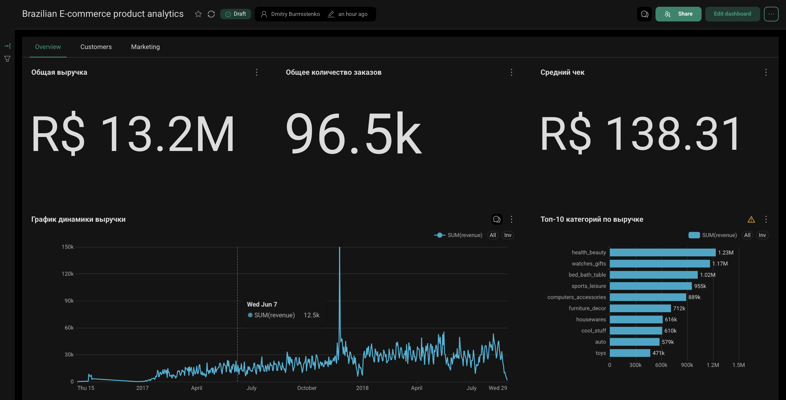
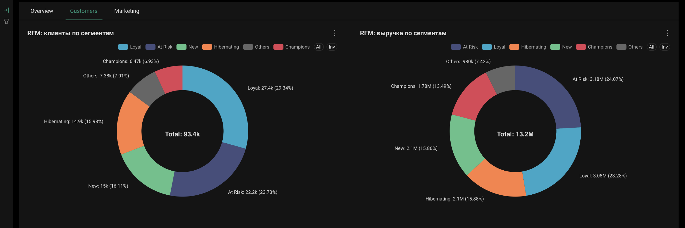
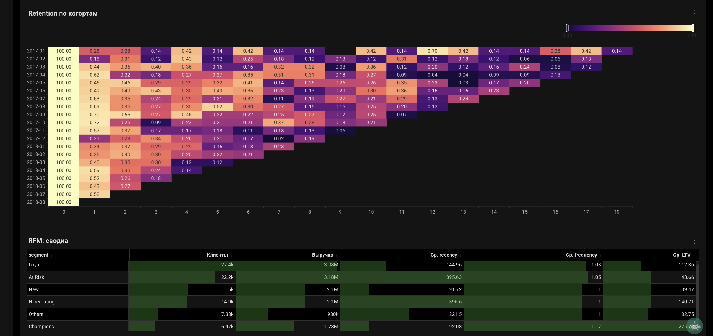
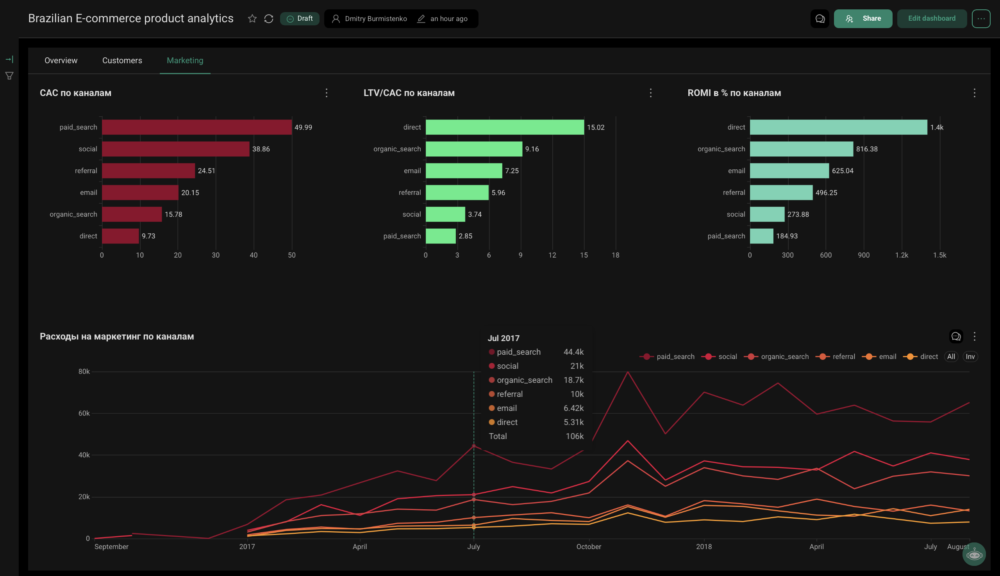
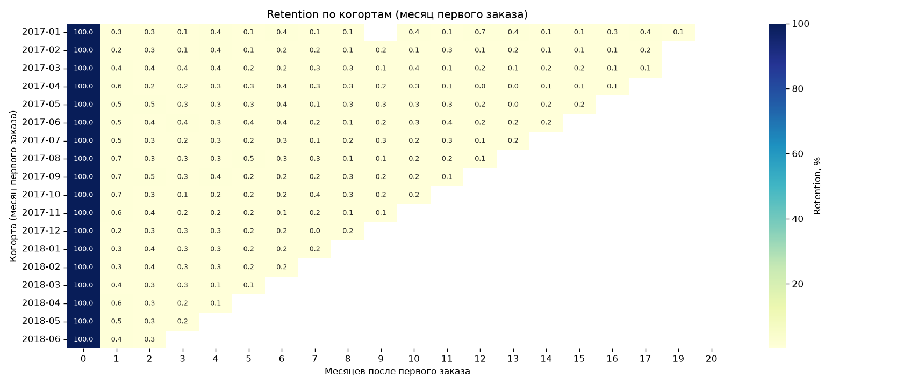
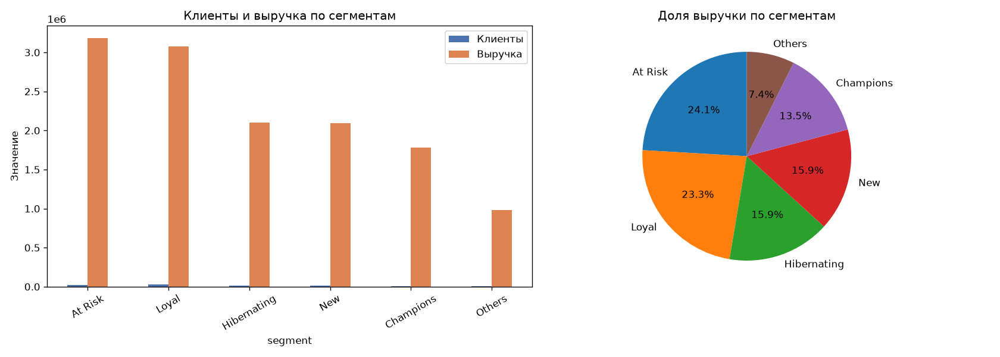
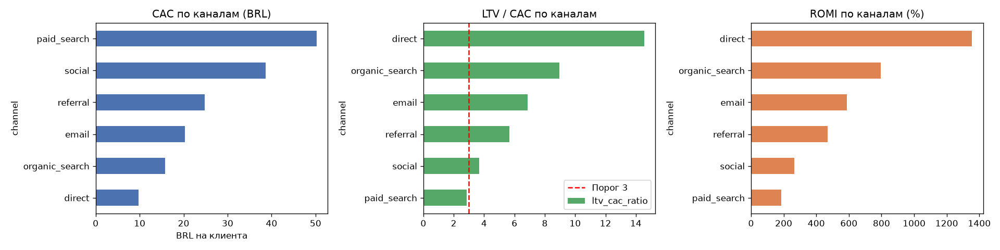
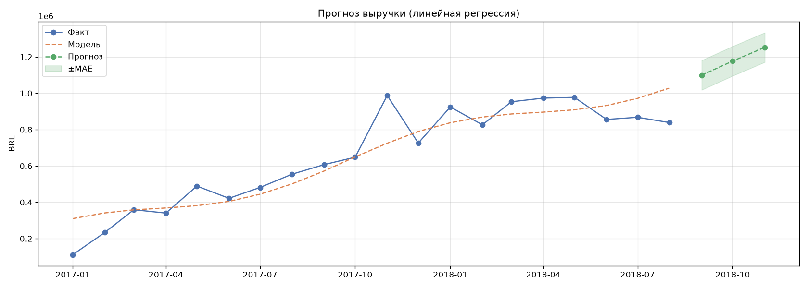
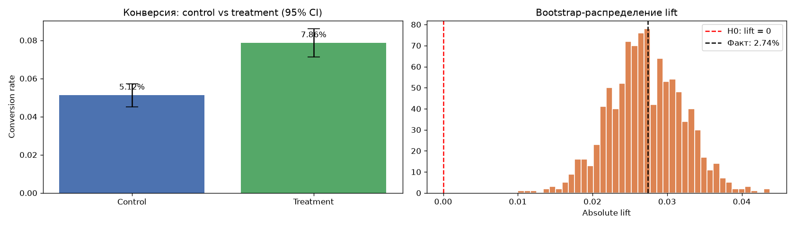

# E-commerce Analytics — сквозной кейс аналитика

Сквозной аналитический проект на данных маркетплейса Olist (Бразилия, 2016–2018, ~96k доставленных заказов). От сырых CSV до интерактивного дашборда и бизнес-рекомендаций.

**Стек:** Supabase (PostgreSQL) · SQL · Python (pandas, scikit-learn, statsmodels) · Apache Superset

---

## Дашборд

**Overview — KPI, динамика выручки, категории**

**Customers — RFM-сегменты и retention**

**Marketing — CAC, LTV/CAC, ROMI по каналам**

---

## Что внутри

- **Данные:** Olist (заказы, клиенты, товары, платежи, отзывы). Маркетинговые расходы — синтетика (в Olist их нет, детали в `src/generate_marketing_data.py`).
- **Модель данных:** staging → marts (звёздная схема: `fact_orders`, `dim_customers`, `dim_products` + витрины).
- **Дашборд Superset:** 3 страницы — Overview, Customers, Marketing.
- **Python-анализ:** когорты, RFM-сегментация, юнит-экономика, линейная регрессия (прогноз), симуляция A/B-теста.

## Ключевые метрики

Revenue · AOV · Retention (M1–M12) · RFM · CAC · LTV · LTV/CAC · ROMI · MAPE · p-value

## Выводы

**Продажи.** Выручка ~13.2M BRL. Топ категорий: `health_beauty`, `watches_gifts`, `bed_bath_table`. Пик — ноябрь 2017 (Чёрная пятница).

**Клиенты.** 97% покупают **один раз** — особенность маркетплейса, не ошибка. Retention M1 = 3–5%, к M6 <1%. **Loyal (~7% клиентов) дают ~15% выручки**, остальной объём выручки примерно пропорционален долям клиентских сегментов.

Retention по когортам:

RFM-сегменты:

**Юнит-экономика** (синтетические расходы). `direct` и `organic_search` — самые эффективные (LTV/CAC > 10). `paid_search` — на границе (LTV/CAC ≈ 3). Убыточных каналов нет.

**Прогноз.** Линейная регрессия (тренд + сезонность через sin/cos): MAPE ~18%, R² ~0.5. Прогноз на 3 месяца — в `notebooks/05_regression.ipynb`.

**A/B-тест (симуляция).** Промо на «At Risk» (n=5000/группа): 5% → 8%, p < 0.001. **Но при типичных параметрах (AOV=150, маржа 30%, промо=20 BRL) кампания убыточна** (−186k BRL). Статистическая значимость ≠ бизнес-выгода.

## Рекомендации

1. **Масштабировать** `organic_search` и `direct` — низкий CAC, высокий LTV/CAC.
2. **Не отключать** `paid_search`, но следить за CAC — при росте цен канал уйдёт в минус.
3. **Главный рычаг — retention**, не привлечение: рост доли повторных покупок с 3% до 10% = ~2× LTV при том же CAC. Конкретно: onboarding + скидка на 2-й заказ, win-back на сегмент «At Risk».
4. **Не раскатывать** массовое промо — считать profit, а не только lift.

## Ограничения

- Нет реальных маркетинговых расходов — данные синтетические.
- Нет A/B в исходных данных — симуляция.
---